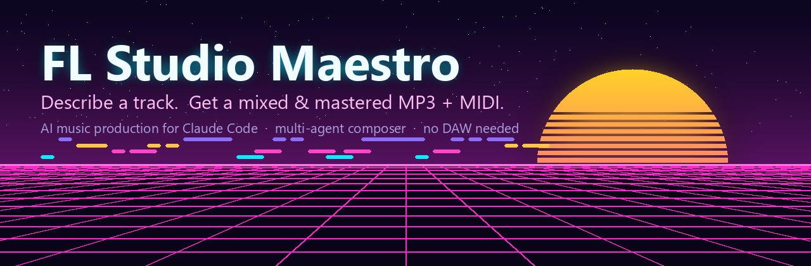
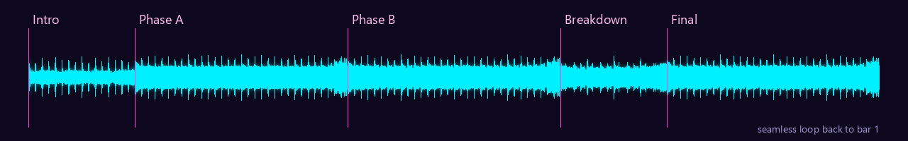
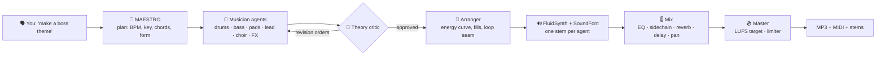

<p align="center">
  
</p>

<h3 align="center">AI music, game sound effects and video soundtracks for Claude Code.</h3>

<p align="center">
  Describe a track and get a mixed and mastered <b>MP3 + MIDI</b>. Ask for <b>unique game SFX</b>
  (coins, footsteps, water, whooshes) synthesized from scratch. Hand it a <b>video</b> and get it back
  scored, with the music ducked under the voice. <b>No DAW, no plugins, no setup.</b>
</p>

<p align="center">
  <a href="https://github.com/feronline/fl-studio-maestro/actions/workflows/tests.yml"></a>
  
  <a href="LICENSE"></a>
  
  
  
  
</p>

<p align="center">
  <a href="#-listen">Listen</a> ·
  <a href="#-quick-start">Quick start</a> ·
  <a href="#-game-sound-effects">Game SFX</a> ·
  <a href="#-score-a-video">Video scoring</a> ·
  <a href="#-how-it-works">How it works</a> ·
  <a href="#-genres">Genres</a> ·
  <a href="#-fl-studio-integration-optional">FL Studio</a> ·
  <a href="#-faq">FAQ</a>
</p>

---

## 🎧 Listen

**"Neon Tyrant"**, a dark synthwave boss fight loop. It was made from one sentence, with no human
editing:

<p align="center">
  <a href="docs/demo/neon-tyrant.mp3"></a>
</p>

<p align="center">
  <a href="docs/demo/neon-tyrant.mp3"><b>▶ Play neon-tyrant.mp3</b></a> &nbsp;·&nbsp; 140 BPM · D harmonic minor · Dm–Bb–Gm–A · 32 bars · 55 s seamless loop · −14 LUFS
</p>

```
You:      make a dark synthwave boss fight theme, loopable

[MAESTRO] -> Plan: 140 BPM, D harmonic minor, Dm-Bb-Gm-A, 32 bars, seamless loop. Casting 7 agents.
[DRUMS]   -> 6 patterns: intro pulse, phase A, section hit, open-hat drive, tom fill, heartbeat
[BASS]    -> octave pump, gallop, breakdown drone
[LEAD]    -> boss theme on the C# leading tone, plus an octave-up "rage answer"
[CRITIC]  -> 19 patterns reviewed: 0 errors, 0 warnings
[MIX]     -> sidechain on, reverb and delay sends set, bass mono, choir wide
[MASTER]  -> -14 LUFS, peak -1.0 dB, reverb tail wrapped into bar 1
          -> neon-tyrant.mp3  neon-tyrant.mid  (+ stems on request)
```

## ✨ Features

| | |
|---|---|
| 🗣️ **Plain-language brief** | Ask in any language. Maestro asks at most 4 quick questions (instruments, loop, length, delivery), and every one has a "you decide" answer. |
| 🎻 **Multi-agent band** | Every instrument is its own agent, with its own sound, patterns and note band. Choirs, strings and FX layers are added when the track needs them. |
| 🧠 **Theory critic** | Deterministic checks for out-of-scale notes, chord clashes, kick/bass flams, register masking, robotic velocities, monotony and loop seams. Every issue goes back to the agent that caused it as a revision order. |
| 🎚️ **Automatic mix** | High-pass and mud EQ, kick sidechain, convolution reverb, tempo-synced ping-pong delay, panning and stereo width. |
| 🔊 **Mastering** | K-weighted loudness normalization to -14, -16 or -10 LUFS, a look-ahead limiter at -1 dB, and seamless loops for games. |
| 📦 **Real deliverables** | MP3, a multi-track MIDI file for any DAW, and optional per-instrument WAV stems. |
| 🪙 **Unique game SFX** | 16 sound types (coin, footsteps on 9 surfaces, water, whoosh, laser, explosion...) synthesized from scratch in 5 styles. Every take is a variation, and a seed reproduces it. |
| 🎬 **Video scoring** | Watches your video (keyframes, scene cuts, speech), picks a tempo that lands on the cuts, ducks the music under the voice and returns the finished MP4. |
| 🔎 **Reference mode** | "In the style of..." a song, film or game: researches it, or analyzes your audio file (tempo, key, energy), then writes something original in that spirit. |
| 🎛️ **FL Studio bridge** | Optional: drives a live FL Studio session (tempo, channels, mixer levels, routing, plugin parameters). |
| ✅ **Graded tool list** | The MCP tool list scores **A (100/100)** with [mcp-anything](https://github.com/gabrielekarra/mcp-anything), and CI enforces it. |

## 🚀 Quick start

**1. Install the plugin in [Claude Code](https://claude.com/claude-code)**
```
/plugin marketplace add feronline/fl-studio-maestro
/plugin install fl-studio-maestro@fl-studio-maestro
```

**2. Ask for music**
```
make me a cozy lo-fi loop for a farming game menu
```

That is all. The only requirement is [uv](https://docs.astral.sh/uv/) (`winget install astral-sh.uv`
or `brew install uv`). The first render downloads the synth engine, the instrument sounds and the
MP3 encoder by itself, about 35 MB. On macOS and Linux, also run `brew install fluid-synth` or
`sudo apt install fluidsynth`.

Files are saved **in the folder you opened Claude Code in**, or anywhere you say:

| File | Use it for |
|---|---|
| `<song>.mp3` | Listening, games, videos, streams. Mixed and mastered. |
| `<song>.mid` | Any DAW (FL Studio, Ableton, Logic, Reaper, Cubase), with one track per instrument |
| `<song>-stems/*.wav` | Remixing. One processed stem per agent, on request. |

## 🪙 Game sound effects

> *"I need a coin sound, a jump, and footsteps on grass and wood for my pixel-art platformer."*

Store-bought SFX packs sound like every other game. The `game-sfx` skill **synthesizes each sound
from scratch** with oscillators, FM, modal metal and bell physics, granular crunch and bubble
acoustics. It also writes several variations of every sound, so your game never plays the same
file twice in a row.

| Sound | Kinds and options |
|---|---|
| 🪙 Rewards | `coin`, `pickup`, `powerup`, `success` |
| 👣 Footsteps | `footstep` on `grass` · `dirt` · `gravel` · `wood` · `stone` · `metal` · `snow` · `sand` · `puddle` |
| 💧 Water | `water`: `drop` · `splash` · `bubbles` · `pour` (bubble physics, not samples) |
| ⚔️ Action | `hit`, `hurt`, `jump`, `laser`, `explosion`, `whoosh` |
| 🖱️ UI | `ui_click`, `ding`, `error`, `magic` |
| 🎨 Styles | `realistic` · `retro` (8-bit) · `cartoon` · `magical` · `scifi`, plus pitch, length, brightness, intensity, and the spaces `dry`, `room`, `hall`, `cave` |

Files land in `sfx/` inside your project as WAV, OGG or MP3, named by game event
(`step_grass_01.wav` … `step_grass_08.wav`). Every set comes with its **seed**: the same seed
gives the same sounds, and any other seed gives brand-new ones.

## 🎬 Score a video

> *"Add music to `reel.mp4`, keep my voice clear, and put whooshes on the cuts."*

1. **Watches** the video: keyframes for Claude to look at, scene cuts, speech segments and the
   original loudness.
2. **Fits** the music to the video: a tempo whose bar lines land on the cuts, exactly the video's
   length, energy in the first two seconds, and a sparser arrangement under speech.
3. **Mixes** for social: the music ducks about 10 dB under the voice and gets a 1-4 kHz pocket.
   Whooshes and hits sit on the cuts. The result is -14 LUFS with a -1 dB peak.
4. **Delivers** `reel_scored.mp4`, its audio as MP3, and the music's MIDI.

## 🧩 How it works



The work runs in 7 stages, each logged as `[AGENT] -> action`:

| # | Stage | Who | Tool |
|---|---|---|---|
| 0 | Brief: up to 4 questions, then autonomous | MAESTRO | Claude Code question UI |
| 1 | Master plan: BPM, meter, key and scale, chords, bar map | MAESTRO | `create_project` |
| 2 | Cast the musicians: sound, band, level, pan | MAESTRO | `register_agent` |
| 3 | Layered composition, humanized, 2-3 variations each | Musicians | `write_pattern` |
| 4 | Rehearsal and critique until clean | CRITIC | `review_project` |
| 5 | Arrangement and energy curve | ARRANGER | `arrange` |
| 6-7 | Render, mix, master, final report | MIX + MASTERING | `render_audio` |

## 🎼 Genres

Maestro ships a genre playbook with tempo, scale, progression, form and cast for each style.
Blends work too, for example "orchestral trap" or "Balkan drum & bass".

| Area | Styles |
|---|---|
| 🎮 **Game music** | boss fight, main menu, exploration, psychological horror, 8-bit chiptune, RPG fantasy, cyberpunk, cozy lo-fi, seamless loops |
| 🎬 **Film and TV** | epic orchestral, drama, thriller, action, minimalist, leitmotif themes |
| 🎭 **Stage** | opera (aria, chorus, recitative), musical theatre, ballet |
| 🎤 **Pop and urban** | pop, synth-pop, R&B, funk, disco, trap, drill, boom bap, phonk, afrotrap |
| 🎸 **Rock and metal** | classic, punk, grunge, thrash, symphonic metal, post-rock, shoegaze |
| 🎛️ **Electronic** | house, techno, trance, dubstep, drum & bass, synthwave, ambient, IDM |
| 🌍 **Jazz and world** | swing, bebop, blues, Turkish makam (Hijaz), Balkan odd meters, Middle Eastern, Japanese (hirajoshi), Celtic |

## 🎹 FL Studio integration (optional)

If you produce in FL Studio, Maestro can also drive your live session through a small controller
script:
- set the tempo and the transport;
- name, colour and route channels;
- set mixer faders in exact dB, pan and stereo width;
- tweak any plugin parameter, such as EQ bands, reverb mix or the limiter ceiling.

FL Studio 2026 blocks sockets and files inside scripts, so the bridge talks MIDI SysEx over two
virtual ports. That is why this path needs a one-time setup:

<details>
<summary><b>One-time FL Studio setup</b></summary>

1. `uvx --from git+https://github.com/feronline/fl-studio-maestro fl-maestro setup` installs the bridge script.
2. `winget install TobiasErichsen.loopMIDI`, then create the ports **Maestro** and **Maestro Reply**.
3. In FL, open **Options > MIDI settings**:
   - Input **Maestro**: enable it, set the controller type to **Maestro Bridge**, port 10.
   - Output **Maestro Reply**: port 10.
4. `uvx --from git+https://github.com/feronline/fl-studio-maestro fl-maestro doctor` should say *connected*.

Then pick *"also build it live in my FL Studio"* when Maestro asks. FL's API cannot create notes
or load plugins, so you drag the exported `.mid` in once, and Claude configures the rest.
</details>

## 🔧 Tools

<details>
<summary><b>23 MCP tools · 3 skills (maestro, game-sfx, score-video)</b></summary>

| Group | Tools |
|---|---|
| Plan and compose | `create_project`, `get_project`, `register_agent`, `write_pattern`, `arrange` |
| Quality | `review_project` |
| Deliver | `render_audio`, `export_project` |
| Sound effects | `make_sfx` |
| Reference and video | `analyze_audio`, `analyze_video`, `score_video` |
| FL Studio live | `fl_status`, `fl_inspect`, `fl_apply_session`, `fl_configure_channel`, `fl_configure_mixer_track`, `fl_plugin_params`, `fl_set_plugin_param`, `fl_set_tempo`, `fl_transport`, `fl_stage_pattern`, `fl_save_project` |

Critic checks: `out_of_scale`, `out_of_range`, `chord_clash`, `kick_bass_flam`, `register_masking`,
`mechanical_velocity`, `duplicate_variation`, `monotony`, `silent_bars`, `loop_seam`, `gain_staging`.
</details>

<details>
<summary><b>Configuration</b></summary>

| Variable | Default | Purpose |
|---|---|---|
| `FL_MAESTRO_OUTPUT_DIR` | the folder Claude Code runs in | Where finished files go |
| `FL_MAESTRO_HOME` | `~/FLMaestro` | Project sessions, working files, downloaded tools |
| `FL_MAESTRO_SOUNDFONT` | GeneralUser GS | Your own `.sf2`/`.sf3` for different sounds |
| `FL_MAESTRO_FLUIDSYNTH` | auto | Path to a FluidSynth binary |
| `FL_MAESTRO_FL_USER_DIR` | `Documents/Image-Line/FL Studio` | FL user data folder |
| `FL_MAESTRO_TO_FL_PORT` / `FL_MAESTRO_FROM_FL_PORT` | `Maestro` / `Maestro Reply` | MIDI ports of the FL bridge |
</details>

## ❓ FAQ

**Is this an AI music generator?**
Yes, but not a black box. Claude writes real notes, as MIDI, with a team of specialist agents and
music-theory checks. Then it renders them to audio. You get the MP3 and the editable MIDI, so you
can change any note.

**Do I need FL Studio or any DAW?**
No. The MP3 and MIDI come out without any DAW installed. FL Studio is an optional extra for
producers who want the session live in FL.

**Is it free? Can I use the music commercially?**
The plugin is MIT licensed. The default sounds come from
[GeneralUser GS](https://github.com/mrbumpy409/GeneralUser-GS), which permits commercial use of
music made with it.

**How good does it sound?**
Clean and balanced, with General MIDI style instrument sounds. For a richer sound, point
`FL_MAESTRO_SOUNDFONT` at a higher-quality SoundFont, or open the MIDI in your DAW with your own
synths.

**Can it make game music loops?**
Yes. Choose "seamless loop". The arranger ends every layer on the bar line, the critic checks
the seam, and the renderer wraps the reverb tail into bar 1.

**Can it make sound effects for my game?**
Yes. Ask for the sounds you need: coins, footsteps on grass or stone, water splashes, UI clicks,
lasers, explosions and more. Each one is synthesized from scratch in your chosen style, with
several variations, as WAV or OGG files ready for Unity, Godot or any engine.

**Can it add music to my Instagram or TikTok video?**
Yes. Give it the video file. It looks at the frames, finds the cuts and the speech, composes music
of the exact length, ducks it under the voice and returns the finished MP4.

**Can I ask for "something like" a song or a film score?**
Yes. Maestro researches the reference, or analyzes the audio file you give it, and writes an
original piece with the same feel: tempo, key, instruments and energy. It never copies the melody.

**Which languages can I ask in?**
Any language. Maestro answers and asks its questions in your language.

## 🧪 Development

```bash
git clone https://github.com/feronline/fl-studio-maestro && cd fl-studio-maestro
pip install -e ".[dev]"
pytest                                     # composition, critic, render DSP, FL bridge against a fake FL
mcp-anything grade "python -m fl_maestro"  # keep the tool list at grade A
```

`CLAUDE.md` holds the full MAESTRO OS system prompt, so running `claude` inside the clone puts you
straight into the studio. Pull requests are welcome, especially genre playbooks, critic rules and
better mix presets.

## 🙏 Credits

- [mcp-anything](https://github.com/gabrielekarra/mcp-anything) by Gabriele Karra grades the MCP server.
- [FluidSynth](https://www.fluidsynth.org/) (LGPL) and [GeneralUser GS](https://github.com/mrbumpy409/GeneralUser-GS) by S. Christian Collins are downloaded at runtime.
- FL Studio is a trademark of Image-Line. This project is not affiliated with Image-Line.

<p align="center"><sub>MIT licensed · If Maestro made you a track you like, a ⭐ helps others find it.</sub></p>
