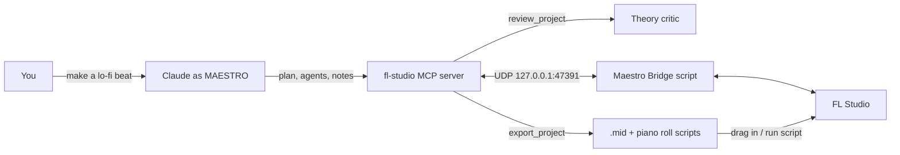

# FL Studio Maestro

**MAESTRO OS: a multi-agent music production studio for FL Studio, run by Claude.**

[](https://github.com/feronline/fl-studio-maestro/actions/workflows/tests.yml)

[](LICENSE)


> *"Make me a relentless boss-fight loop, dark synthwave."*
>
> `[MAESTRO] -> Plan: 150 BPM, 4/4, D harmonic minor, Dm-Bb-Gm-A, 48 bars, loopable. Casting 7 agents.`
> `[TAIKO] -> ch 0 (FPC) -> drums-a, drums-b, drums-fill written.`
> `[CRITIC] -> lead-b bar 6: D#5 outside D harmonic minor -> revision to LEAD SYNTH.`
> `[MIX] -> tracks 1-7 balanced, 808 mono, choir spread ±0.3, master at -6 dB.`

Claude plays **MAESTRO**, the conductor. It does not write a track as one block of notes. It
casts a team of musician agents (808 bass, choir sopranos, staccato strings, lead synth...).
Each agent gets its own instrument, Channel Rack slot, patterns and mixer track, then:

1. a **theory critic** checks every part for wrong notes, chord clashes, kick/bass flams,
   masking and mechanical velocities,
2. an **arranger** builds the energy curve,
3. a **mix engineer** and a **mastering engineer** finish the track, live inside FL Studio.

It works for any style: game music (boss, menu, horror, chiptune), film scores, opera and
musical theatre, pop, trap and drill, rock and metal, EDM, jazz, and world music including
makam flavours, Balkan and Japanese scales.

## What is in the box

| Part | What it does |
|---|---|
| `maestro` skill | The conductor: the 7-stage workflow, the agent ID cards, plus a genre, roster and mixing playbook |
| `fl-studio` MCP server | 18 tools: plan, compose, critique, arrange, export, and drive FL Studio live |
| Maestro Bridge | An FL Studio controller script that runs the commands inside FL (local UDP, 127.0.0.1 only) |
| Piano roll scripts | One generated script per pattern, which writes the notes into FL's piano roll |
| `CLAUDE.md` | The full MAESTRO OS system prompt, so running `claude` in a clone puts you straight into the studio |

The MCP server's tool list is graded **A (100/100)** by [mcp-anything](https://github.com/gabrielekarra/mcp-anything)
(`mcp-anything grade`), and CI keeps it that way.

## How it works



FL Studio has no external API. The bridge is an FL controller script, so it can only do what
FL's MIDI scripting API allows. Everything it can do happens live:

| Live, by Claude | Once, by you |
|---|---|
| Tempo, play/stop/record, save | Load the instrument and effect plugins (FL's API cannot load plugins) |
| Channel names, colours, volume, pan, mixer routing | Drag the exported `.mid` into FL, or run a *Maestro* piano roll script |
| Mixer faders in dB, pan, stereo width, mute, sends | |
| Any plugin parameter: EQ bands, reverb mix, limiter ceiling, synth cutoff | |
| Pattern names; open a pattern's piano roll on the right channel | |

## Install

You need FL Studio 2024 or later, [uv](https://docs.astral.sh/uv/) and Claude Code.

### 1. Add the plugin to Claude Code
```
/plugin marketplace add feronline/fl-studio-maestro
/plugin install fl-studio-maestro@fl-studio-maestro
```
This adds the `maestro` skill and the `fl-studio` MCP server. uv runs the server on demand.

### 2. Connect FL Studio (once)
```bash
uvx --from git+https://github.com/feronline/fl-studio-maestro fl-maestro setup
```
1. Install [loopMIDI](https://www.tobias-erichsen.de/software/loopmidi.html) and create a port named **Maestro**.
   On macOS, enable the IAC Driver in Audio MIDI Setup instead.
2. Restart FL Studio and open **Options > MIDI settings**. Select the **Maestro** input, tick **Enable**,
   and set **Controller type** to **Maestro Bridge**.
3. Check the connection:
```bash
uvx --from git+https://github.com/feronline/fl-studio-maestro fl-maestro doctor
```

Without FL Studio connected, Maestro still plans, composes, reviews, arranges and exports. You
import the result yourself.

### Or: work inside this repo
```bash
git clone https://github.com/feronline/fl-studio-maestro && cd fl-studio-maestro
pip install -e .
claude mcp add fl-studio -- fl-maestro-mcp
claude          # CLAUDE.md puts Claude in the MAESTRO role
```

## Use it

Just ask:
- *"Produce a cozy lo-fi loop for a farming game menu."*
- *"Epic orchestral boss theme in 7/8 with a Latin choir."*
- *"UK drill beat, 142 BPM, sliding 808s."*
- *"A Hijaz-flavoured cinematic intro, 90 seconds."*

Maestro follows the 7 stages:

| Stage | Agent | Tools |
|---|---|---|
| 0. Connection check | MAESTRO | `fl_status`, `fl_inspect` |
| 1. Master plan (BPM, key, chords, bar map) | MAESTRO | `create_project` |
| 2. Cast and set up the musicians | MAESTRO | `register_agent`, `fl_apply_session` |
| 3. Layered composition, humanized, 2-3 variations per agent | Musicians | `write_pattern` |
| 4. Rehearsal and theory review | CRITIC | `review_project` |
| 5. Arrangement into FL | ARRANGER | `arrange`, `export_project`, `fl_stage_pattern` |
| 6. Mix | MIX | `fl_configure_mixer_track`, `fl_plugin_params`, `fl_set_plugin_param` |
| 7. Master, save, final report | MASTERING | `fl_set_plugin_param`, `fl_save_project` |

Then it delivers the final production report: tempo, key, chords, length, the agent, channel,
pattern and mixer map, and revision ideas.

### Getting notes into FL Studio
- **The whole song:** `export_project` writes one multi-track `.mid` with tempo, meter and
  section markers, with one track per agent in Channel Rack order. Drag it into an empty FL
  project. Claude then runs `fl_apply_session` to name, colour, route and level every channel and mixer track.
- **One pattern:** `fl_stage_pattern` selects the pattern and channel and opens the piano roll.
  Run **Scripts > Maestro - …** and press Accept.

## The critic's checks

`review_project` is deterministic. Each issue names the agent and pattern, where it happens, and a fix.

| Check | Catches |
|---|---|
| `out_of_scale` | Notes outside the project key and scale (unpitched roles are exempt) |
| `out_of_range` | Notes outside the agent's frequency band |
| `chord_clash` | Bass notes that are not chord tones at a chord change |
| `kick_bass_flam` | Bass onsets 0.02-0.125 beats off a kick |
| `register_masking` | Two melodic agents in the same register in the same bars |
| `mechanical_velocity` | Flat velocities (humanization is mandatory) |
| `duplicate_variation`, `monotony` | Copy-paste variations; one pattern carrying a whole song |
| `silent_bars`, `loop_seam` | Unplanned gaps; game loops that do not wrap cleanly |
| `gain_staging` | Agents set above 0 dB |

## Configuration

| Variable | Default | Purpose |
|---|---|---|
| `FL_MAESTRO_HOME` | `~/FLMaestro` | Project sessions and exported `.mid` files |
| `FL_MAESTRO_FL_USER_DIR` | `Documents/Image-Line/FL Studio` | FL user data folder, if you moved it |
| `FL_MAESTRO_PORT` | `47391` | UDP port of the bridge (also change `PORT` in the device script) |
| `FL_MAESTRO_TIMEOUT` | `3` | Seconds to wait for FL Studio |

## Development

```bash
pip install -e ".[dev]"
pytest                                   # drives the real device script against a fake FL over real UDP
mcp-anything grade "python -m fl_maestro"  # keep the tool list at grade A
```

Layout: `src/fl_maestro/` holds the server, theory, critic, export and bridge client.
`src/fl_maestro/fl_scripts/` holds the FL-side script. The plugin, skill and references are in
`plugins/fl-studio-maestro/`.

## Credits
- [mcp-anything](https://github.com/gabrielekarra/mcp-anything) by Gabriele Karra, used to grade the MCP server and install it into clients.
- FL Studio is a trademark of Image-Line. This project is not affiliated with Image-Line.

MIT licensed.
