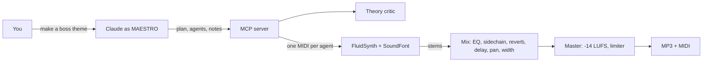

# FL Studio Maestro

**Describe a track. Get a mixed and mastered MP3 + MIDI. No DAW, no plugins, no setup.**

[](https://github.com/feronline/fl-studio-maestro/actions/workflows/tests.yml)

[](LICENSE)


> **You:** *make a dark synthwave boss fight theme*
>
> **Claude:** asks 4 quick questions (instruments, loop, length, delivery), each with a "you decide" option
>
> ```
> [MAESTRO]  -> Plan: 140 BPM, D harmonic minor, Dm-Bb-Gm-A, 32 bars (55 s), seamless loop. Casting 7 agents.
> [DRUMS]    -> 6 patterns: intro pulse, phase A, section hit, open-hat drive, tom fill, heartbeat
> [CRITIC]   -> bass-groove bar 3: G3 outside the bass band -> revision ordered to OCTAVE BASS
> [MIX]      -> sidechain on, reverb and delay sends set, bass mono, choir wide
> [MASTER]   -> -14 LUFS, peak -1.0 dB, loop tail wrapped into bar 1
> ```
> **neon-tyrant.mp3** · **neon-tyrant.mid** (+ stems on request)

Claude plays **MAESTRO**, the conductor. It does not write a track as one block of notes. It
casts a team of musician agents (808 bass, choir, staccato strings, lead synth...), each with its
own sound, patterns and note band. Then:
- a **theory critic** checks every part for wrong notes, chord clashes, kick/bass flams, masking
  and mechanical velocities;
- an **arranger** shapes the energy curve;
- a **mix engineer** and a **mastering engineer** render the finished track.

It works for any style: game music (boss, menu, horror, chiptune, loops), film scores, opera,
pop, trap and drill, rock and metal, EDM, jazz, and world music including makam, Balkan and
Japanese scales.

## Install (once)

In Claude Code:
```
/plugin marketplace add feronline/fl-studio-maestro
/plugin install fl-studio-maestro@fl-studio-maestro
```
The only requirement is [uv](https://docs.astral.sh/uv/), which runs the server. Everything else
is downloaded the first time you render, about 35 MB in total:
- [FluidSynth](https://www.fluidsynth.org/), the synth engine;
- the [GeneralUser GS](https://github.com/mrbumpy409/GeneralUser-GS) SoundFont, the instrument
  sounds;
- ffmpeg, the MP3 encoder.

On macOS and Linux, install FluidSynth with `brew install fluid-synth` or
`sudo apt install fluidsynth`.

## Use it

Just ask, in any language:
- *"Produce a cozy lo-fi loop for a farming game menu."*
- *"Epic orchestral boss theme in 7/8 with a Latin choir, 2 minutes."*
- *"UK drill beat, 142 BPM, sliding 808s, no melody."*
- *"Bana Hicaz makamında sinematik bir intro yap."*

You get:

| File | For |
|---|---|
| `<song>.mp3` | Listening, your game, your video: mixed and mastered (-14 LUFS, -1 dB peak) |
| `<song>.mid` | Any DAW (FL Studio, Ableton, Logic, Reaper...), with every agent on its own track |
| `stem-*.wav` (optional) | One mixed stem per instrument, for remixing |

Files land in `~/FLMaestro/<song>/render/`.

### How the sound is made



## Optional: build it live in FL Studio

FL Studio users can also have Claude drive FL itself: tempo, channel and mixer names, levels,
routing, and plugin parameters such as EQ bands, reverb and limiter. This uses a small controller
script, because FL Studio 2026 blocks sockets and files inside scripts. That makes MIDI SysEx
over two virtual ports the only way in, so this path needs one-time setup:

1. `uvx --from git+https://github.com/feronline/fl-studio-maestro fl-maestro setup` installs the script.
2. Install [loopMIDI](https://www.tobias-erichsen.de/software/loopmidi.html) (`winget install TobiasErichsen.loopMIDI`) and create ports named **Maestro** and **Maestro Reply**.
3. In FL, open **Options > MIDI settings**:
   - Input **Maestro**: enable it, set the controller type to **Maestro Bridge**, port 10.
   - Output **Maestro Reply**: port 10.
4. Check the connection: `uvx --from git+https://github.com/feronline/fl-studio-maestro fl-maestro doctor`.

Then choose *"also build it live in my FL Studio"* when Maestro asks. FL's API cannot create notes
or load plugins, so you drag the exported `.mid` in once, and Claude configures the rest.

## Tools

| Stage | Agent | Tools |
|---|---|---|
| Plan | MAESTRO | `create_project`, `get_project` |
| Cast | MAESTRO | `register_agent` |
| Compose | Musicians | `write_pattern` |
| Critique | CRITIC | `review_project` |
| Arrange | ARRANGER | `arrange` |
| Render, mix, master | MIX + MASTERING | `render_audio` |
| FL Studio (optional) | all | `fl_status`, `fl_inspect`, `fl_apply_session`, `fl_configure_channel`, `fl_configure_mixer_track`, `fl_plugin_params`, `fl_set_plugin_param`, `fl_set_tempo`, `fl_transport`, `fl_stage_pattern`, `fl_save_project`, `export_project` |

The tool list is graded **A (100/100)** by [mcp-anything](https://github.com/gabrielekarra/mcp-anything),
and CI keeps it that way.

### The critic's checks
`out_of_scale`, `out_of_range` (outside the agent's band), `chord_clash` (bass at chord changes),
`kick_bass_flam`, `register_masking`, `mechanical_velocity`, `duplicate_variation`, `monotony`,
`silent_bars`, `loop_seam` and `gain_staging`. Every issue names the agent, the pattern, the
position in the song and a fix.

## Configuration

| Variable | Default | Purpose |
|---|---|---|
| `FL_MAESTRO_HOME` | `~/FLMaestro` | Projects, renders and downloaded tools |
| `FL_MAESTRO_SOUNDFONT` | GeneralUser GS | Use your own `.sf2`/`.sf3` for different sounds |
| `FL_MAESTRO_FLUIDSYNTH` | auto | Path to a FluidSynth binary |
| `FL_MAESTRO_FL_USER_DIR` | `Documents/Image-Line/FL Studio` | FL user data folder (FL path only) |
| `FL_MAESTRO_TO_FL_PORT` / `FL_MAESTRO_FROM_FL_PORT` | `Maestro` / `Maestro Reply` | MIDI ports of the FL bridge |

## Development

```bash
pip install -e ".[dev]"
pytest                                     # composition, critic, render DSP, and the FL bridge against a fake FL
mcp-anything grade "python -m fl_maestro"  # keep the tool list at grade A
```
`CLAUDE.md` contains the full MAESTRO OS system prompt, so running `claude` in a clone puts you
straight into the studio.

## Credits
- [mcp-anything](https://github.com/gabrielekarra/mcp-anything) by Gabriele Karra, used to grade the MCP server.
- [FluidSynth](https://www.fluidsynth.org/) (LGPL) and [GeneralUser GS](https://github.com/mrbumpy409/GeneralUser-GS) by S. Christian Collins, both downloaded at runtime.
- FL Studio is a trademark of Image-Line. This project is not affiliated with Image-Line.

MIT licensed.
